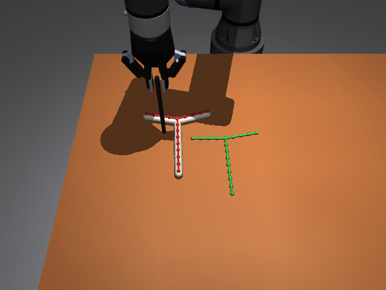

# DL Assignment 01 — 텔레오퍼레이션으로 시연 데이터 모으고 모방학습하기

로봇(UR5e)이 쥔 막대로 T자 로프를 밀어서 초록색 목표 T 위에 올려놓는 MuJoCo 시뮬레이터입니다.
이 과제에서는

1. 시뮬레이터를 설치하고 실행합니다.
2. 키보드로 로봇을 직접 조종(teleoperation)해서 시연 데이터를 모읍니다.
3. 로프·목표·막대의 **위치 정보**만 보고 행동을 예측하는 모방학습(behaviour cloning) 정책을 구현합니다.
4. 학습한 정책을 시뮬레이터에서 직접 돌려 성공률을 재고, 결과를 영상(mp4)으로 만듭니다.
5. 보고서, 발표 PPT, YouTube 발표 영상으로 결과를 정리합니다.

정책의 입력은 **이미지가 아니라 키포인트(위치) 정보**입니다: 로프 키포인트 19개, 목표 T 키포인트 19개, 막대 끝 위치.

단계별 설명은 [TUTORIAL.md](TUTORIAL.md)에 있습니다.



## 설치

Python 3.10–3.12를 권장합니다. GPU는 필요 없습니다.

```bash
git clone https://github.com/jooyongsim/deeplearning_SMWU_2026.git DL_assignment01 && cd DL_assignment01
python -m venv .venv
# Windows:  .venv\Scripts\activate        macOS / Linux:  source .venv/bin/activate
pip install -r requirements.txt
python -m pip install -r requirements.txt
```

```
deactivate

py install 3.12

py -3.12 -m venv .venv312

.venv312\Scripts\activate

python -m pip install --upgrade pip

python -m pip install -r requirements.txt
```
설치 확인:

```bash
python scripts/check_env.py --student <학번>
```

`PASSED`가 나오면 됩니다.
실행할 때마다 나오는 `[robosuite WARNING] ... macro file`, `robosuite_models`, `mink` 경고는 이 과제와 관계가 없으니 무시해도 됩니다.

## 빠른 시작: teleop

```bash
python teleop.py --student <학번>
```

| 키 | 동작 |
|---|---|
| 방향키 (누르고 있기) | 막대 끝을 테이블 평면에서 이동 (화면 기준, 위 = 카메라에서 멀어지는 쪽) |
| PgUp / PgDn | 막대 끝 위 / 아래 |
| Shift | 최고 속도 (기본은 절반) |
| Enter | 이 에피소드 저장, 다음 시드로 |
| Delete | 저장하지 않고 같은 시드 다시 시작 |
| 창 닫기 | 종료 (진행 중인 에피소드는 저장하지 않음) |

빨간 점은 지금 로프의 키포인트 19개, 초록 점은 목표 T입니다. 마우스로 시점을 돌리면 방향키 방향도 함께 돌아갑니다.
터미널에 위치 / 회전 / 모양 오차가 표시되고, 세 값이 모두 기준(50 mm / 15° / 12 mm) 안에 들어오면 `SUCCESS`가 뜹니다.

### 운영체제별 주의

- **Windows / Linux(X11)**: 그대로 됩니다.
- **macOS**: MuJoCo 뷰어는 `mjpython`으로 실행해야 합니다 (`mjpython teleop.py --student <학번>`).
  키 입력을 읽으려면 터미널에 *손쉬운 사용(Accessibility)* 권한이 필요합니다. 권한을 줄 수 없으면 `--keys viewer`를 씁니다.
- **Linux(Wayland)**: 누르고 있는 키를 읽지 못하면 `--keys viewer`를 씁니다.
  이 모드에서는 방향키를 한 번 누르면 그 방향으로 계속 움직이고 `End`로 멈춥니다.

## 구성

```
DL_assignment01/
├── README.md, TUTORIAL.md     설명
├── requirements.txt
├── teleop.py                  [M1, M2] 키보드 teleop → demos/<학번>/ep_<seed>.npz
├── scripts/
│   ├── check_env.py           [M0] 설치 확인 → runs/m0/
│   ├── replay_demo.py         [M2] 저장한 에피소드를 다시 시뮬레이션해서 검증 / 뷰어로 재생
│   ├── inspect_demos.py       [M2] 시연 폴더 검사, 요약표, 그림 → runs/m2/
│   ├── render_video.py        [M4] 저장된 에피소드(평가 rollout, 시연) → mp4 영상
│   └── make_submission.py     [제출] 제출물을 zip 하나로 묶기
├── il/                        모방학습 (TODO가 있는 뼈대)
│   ├── dataset.py             [M3] 시연 → (관측, 행동) 쌍           TODO
│   ├── policy.py              [M3] MLP 정책과 Agent               TODO
│   ├── train_bc.py            [M3] 학습 루프                       TODO
│   ├── check_il.py            [M3] 내 구현 검사 (학습 없이)
│   └── eval_policy.py         [M4] 폐루프 평가 (완성본)
├── sim/                       시뮬레이터 (수정하지 마세요)
│   ├── scene.py               make_env(seed): 장면 생성, 관측 구성, 시드 규칙
│   ├── robot_env.py           UR5e + 막대, 막대 끝 속도 제어
│   ├── rope_env.py            로프 T 모델과 키포인트
│   ├── success.py             성공 판정 (위치 / 회전 / 모양)
│   ├── episode_io.py          에피소드 파일 형식 (저장 / 읽기 / 검사)
│   ├── demo_data.py, level_table.py
├── data/                      실제 시연에서 맞춘 로프 물성, 시작 자세, 목표 T
└── docs/report_template.md    보고서 양식
```

## Milestone과 제출물

| | 내용 | 제출물 (만드는 명령) |
|---|---|---|
| **M0** | 설치와 실행 | `runs/m0/check_env.json`, `runs/m0/scene.png` (`scripts/check_env.py`) |
| **M1** | teleop으로 로프를 목표까지 밀기 | 성공한 에피소드 1개 이상, 화면 녹화 30초 이상 `runs/m1/teleop.mp4` |
| **M2** | 시연 데이터 수집과 검증 | `demos/<학번>/` 에피소드 **30개 이상**, `runs/m2/summary.csv·summary.json·demos.png` (`scripts/inspect_demos.py`) |
| **M3** | 모방학습 구현 | TODO를 채운 `il/*.py`, `runs/m3/check_il.json` (`il/check_il.py`), 학습 결과 `runs/m3/ckpt.pt·train_log.csv·config.json` |
| **M4** | 폐루프 평가와 결과 영상 | `runs/m4/zero/eval.json`, `runs/m4/bc/eval.json` (50개 평가 시드 전부), 결과 영상 `runs/m4/bc/videos/ep_<seed>.mp4` **3개 이상** (성공·실패 포함, `scripts/render_video.py`) |
| **M5** | 최종 보고서, 발표 PPT, YouTube | `report.pdf` ([docs/report_template.md](docs/report_template.md) 양식), `slides.pptx`(또는 `slides.pdf`), `youtube_url.txt` (5–10분 발표 영상 링크) |

제출: `python scripts/make_submission.py --student <학번>` → `submission_<학번>.zip`

규칙
- 시연은 반드시 `teleop.py --student <본인 학번>`으로 모읍니다. 시드가 학번에서 정해지므로, 다른 사람의 데이터는 시드로 구별됩니다.
- `sim/`과 `data/`는 고치지 않습니다. 평가는 원래 시뮬레이터로 다시 돌려서 확인합니다.
- 평가 시드(`scene.EVAL_SEEDS`, 900000–900049)로 시연을 모으거나 학습하지 않습니다.

## 시뮬레이터 요약

- **관측** (85차원, `sim/scene.py`의 `OBS_LAYOUT`). 위치는 모두 테이블 좌표(m)이고 작업 공간 중심 (-0.15, -0.45) 기준입니다.
  - 로프 키포인트 xy 38: 팔1 0–4, 팔2 5–9, 줄기 10–18. 0, 5, 10번은 모두 교차점입니다.
  - 목표 T 키포인트 xy 38: 같은 순서이고, 모든 에피소드에서 같습니다.
  - 막대 끝 xyz 3
  - 관절각/π 6
- **행동** (3차원): 막대 끝 속도 (x, y, z)를 [-1, 1]로 정규화한 값입니다(로봇 base 좌표). 1은 xy 0.16 m/s, z 0.08 m/s입니다. 제어 주기는 10 Hz입니다.
- **시작 상태**: 시드마다 기준 로프 자세를 최대 3 cm 옮기고 최대 30° 돌립니다. 같은 시드는 언제나 같은 시작입니다.
- **성공**: 키포인트 중심 거리 ≤ 50 mm, 회전 ≤ 15°, 강체 정렬 후 모양 오차 ≤ 12 mm (`sim/success.py`).
- **로프 물성**: 실제 사람 시연 8개를 시뮬에서 재생해서 맞췄습니다 (`data/fit_t.json`: 강성, 감쇠, 테이블 마찰 0.576, 막대 마찰 1.12).

## 출처

`sim/rope_env.py`, `robot_env.py`, `success.py`, `level_table.py`와 `data/`는
[real2sim_deformable](https://github.com/jooyongsim/real2sim_deformable)의 `ropeT_sim_bc`에서 가져왔습니다.
