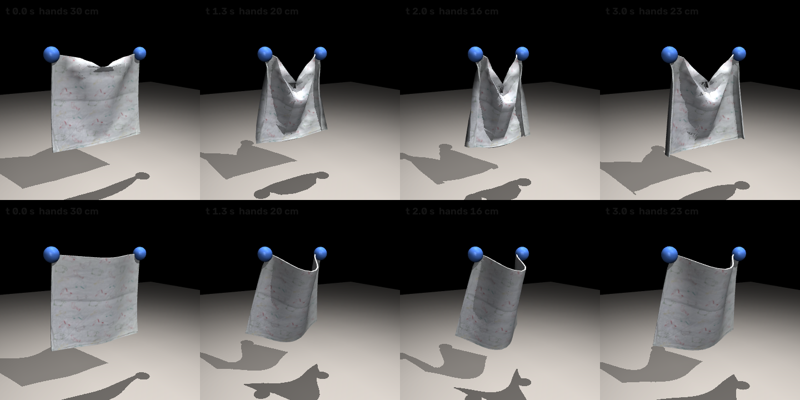

# DL Assignment 02 — Real2Sim: 휴대폰 영상으로 천의 공기 저항과 굽힘 강성 찾기 (v7)

천을 바닥에 펴서 **사진 한 장**을 찍고 자로 두 변을 재서 시뮬레이터 메쉬를 만듭니다. 그다음 그 천을 두 손으로 들고 움직이는 **휴대폰 RGB 영상**을 찍고,
그 영상만으로 MuJoCo 속 천이 영상과 같이 움직이도록 시뮬레이터의 물성을 정합니다. depth 카메라는 쓰지 않습니다.

| 물성 | 영상으로 알 수 있는 것 | 결과 |
|---|---|---|
| **공기 저항** `air` | 값 하나 (손실이 log(air)에 대해 U자) | `air` (N·s/m³, 천 1 m²당) |
| **굽힘 강성** `young` | **상한만** (그보다 부드러운 값은 영상으로 구분 안 됨) | `young_upper`, 그리고 그 아래에서 고른 `young` |

**왜 강성은 상한만인가.** 매달린 천의 모양을 굽힘 강성이 바꾸는 범위는 굽힘 길이(보통 천 1–4 cm) 정도입니다. 천(30 cm 이상)이 그보다 훨씬 크면
모양은 중력과 손 위치로 거의 정해지므로, 부드러운 값들은 모두 영상과 똑같이 잘 맞고 **너무 뻣뻣한 값만 영상과 달라 보입니다.**
교수님 영상 T01(36 × 32 cm, 15 g): 공기 저항 약 0.6에서 손실이 뚜렷이 최소이고, 강성은 1e2–3e4가 모두 같고 1e5부터 나빠졌습니다.
v6까지처럼 평평한 곡선의 최솟값을 답으로 고르면, 같은 데이터로도 3.2e3, 1.5e3, 6.8e3이 나옵니다 (잡음이 고른 값).


*같은 손 움직임, 다른 굽힘 강성: 위 young = 1e3, 아래 1e5. 차이는 모서리와 주름에 주로 나타납니다.*

## 전체 흐름 (Colab 노트북 하나: [notebooks/DL_Assignment02_Real2Sim.ipynb](notebooks/DL_Assignment02_Real2Sim.ipynb))

| 단계 | 하는 일 | 도구 | 내가 쓰는 코드 |
|---|---|---|---|
| ⓪ 메쉬 | 평평하게 편 천의 사진 + 자로 잰 가로 · 세로 → 2 cm 격자 메쉬 | Grounding DINO, SAM 2.1, homography | |
| ① 영상·카메라 | 천 영상과 체커보드 영상을 올리고 카메라 보정 | OpenCV | |
| ② 인식 | 천 찾기 → 분할 → 모서리 4개 → 점 추적 → metric depth | Grounding DINO, SAM 2.1, CoTracker3, Depth Anything V2 | |
| ③ 3-D로 올리기 | 픽셀 + 깊이 → 3-D, 천의 실제 크기로 프레임마다 scale, **영상 속 세로선으로 중력 방향**, 손 궤적 평활 | NumPy | **TODO** `backproject`, `per_frame_scale`, `floor_frame` |
| ④ 시뮬레이터 | 관찰된 두 손의 궤적이 시뮬레이션 천을 움직임 | MuJoCo 4.0.1 (flex: 안 늘어남 + 굽힘 강성 + **공기 저항**) | |
| ⑤a 공기 저항 | young을 고정하고 공기 저항을 훑어 U자 곡선의 최솟값 | MuJoCo (병렬) | **TODO** `frame_loss`, `episode_loss`, `curve_min` |
| ⑤b 강성 상한 | 공기 저항을 고정하고 young을 훑어, 손실이 "바닥 + 시뮬레이터 잡음 × 3"을 벗어나는 곳 | MuJoCo (병렬) | **TODO** `upper_bound` |
| ⑤c 강성 값 | [1e2, 상한]의 log 중간 (최악 오차가 가장 작은 값). 다음 과제에서는 이 범위로 domain randomization | | |
| ⑥ 검증 | 공기 저항과 강성을 아는 합성 영상: 공기 저항을 0.3 decade (2배) 안으로? 정답 강성이 상한 아래? | `r2s/synth.py` | |

**영상 위에서 비교합니다.** Depth Anything V2 Metric은 가까운 천을 1.3–1.7배 멀게, 프레임마다 다르게 봅니다. ③에서 천 크기로 scale을 맞춰도 2 cm 정도 남으므로,
⑤에서는 시뮬레이션 천을 카메라로 투영해 추적한 **픽셀**과 비교합니다 (손실은 천까지 거리에서의 mm로 환산).

## 준비

1. **천**: 줄자로 두 변을 2–3군데 재고(평균), 가능하면 질량도 (주방 저울). 바닥에 평평하게 펴서 네 모서리가 보이게 사진 한 장.
2. **촬영**: [docs/FILMING.md](docs/FILMING.md) — 휴대폰 설정(손떨림 보정 끄기, 초점·노출 고정), 장면(**문틀 · 가구 모서리 같은 세로선**과 바닥이 보이게), 동작, 체커보드
   ([docs/checkerboard_9x6_25mm.pdf](docs/checkerboard_9x6_25mm.pdf), 100 %로 인쇄). take 3개 이상.
3. **Colab**: 노트북을 열고 **런타임 → T4 GPU**, 위에서부터 실행. 저장소는 노트북이 받아 옵니다 (`REPO_URL`, 또는 저장소 zip 업로드).
   ⑤는 시뮬레이션 약 30번(공기 8, 강성 8 + 잡음 4 + 좁히기 2, 합성 검증에 한 번 더)이라 CPU 2개에서 20–30분 걸립니다.
4. 로컬에서 돌리고 싶으면 (GPU 권장): `conda create -n dl_real2sim python=3.11 && pip install -r requirements.txt` 후 같은 노트북. ⑤는 CPU 코어 수만큼 병렬로 돕니다.

## 저장소

```
notebooks/DL_Assignment02_Real2Sim.ipynb   과제 전체 (Colab, 코드 설명 포함): ⓪ 메쉬부터 ⑥ 검증, 결과 zip까지
r2s/   photo2mesh_wh.py  ⓪ 천 사진 + 가로 · 세로 -> 메쉬
       take.py      영상 읽기, 체커보드 보정, 모서리 자동 찾기, 소실점 초점거리
       perceive.py  Grounding DINO, SAM 2.1 (이미지·영상), CoTracker3 (online, 앞뒤), Depth Anything V2 Metric
       lift.py      ③ 3-D로 올리기 (TODO 3개는 노트북에서 작성), 세로선으로 중력 (vertical_candidates, up_from_lines)
       fit.py       ⑤ 공기 저항 (run_air) -> 강성 상한 (run_young) -> 강성 값 (choose_young). TODO 4개는 노트북에서 작성
       synth.py     정답(young, air)을 아는 합성 영상
       viz.py       그림·영상 (plot_air, plot_young)
       check.py     TODO 함수 테스트 13개 (노트북에서 실행)
       photo2mesh.py  참고: 긴 변 하나만 재는 이전 방식
sim/cloth_sim.py    MuJoCo 4.0.1 천 시뮬레이터: young, air, mass (수정하지 마세요)
assets/my_cloth/    ⓪에서 내 천 사진으로 만든 메쉬가 저장되는 곳 (저장소에는 메쉬를 주지 않음: 각 팀이 직접 만듦)
docs/               촬영 가이드, 체커보드, 보고서 양식
```

## 단계와 제출물

| | 내용 | 제출물 |
|---|---|---|
| M0 | 천 사진 → 메쉬 | 메쉬 확인 그림 3장 (마스크, 모서리, 다시 그린 메쉬), 잰 가로 · 세로 · 질량, `aspect_diff_pct` |
| M1 | 촬영과 카메라 보정 | 영상 3개 이상(대표 take 1개는 제출), 체커보드 RMS |
| M2 | 인식 | 노트북 ② 그림 (DINO 상자, SAM 마스크와 모서리, 추적 영상, depth) |
| M3 | 3-D로 올리기 (TODO) | 테스트 통과, 세로선 그림과 잔차, scale·손 간격·3-D 그림 |
| M4 | 공기 저항 → 강성 상한 → 값 (TODO) | 공기 저항 U 곡선과 값, 강성 곡선 · 허용치 · 상한, 고른 young과 이유, 겹쳐 본 영상 |
| M5 | 검증과 보고 | 합성 영상 결과 (공기 저항 오차, 정답 ≤ 상한?), take 간 비교, ablation 1개 이상, 보고서, 발표 |

노트북 마지막 셀이 `results_<팀ID>.zip`(results.json, 메쉬, 그림, 영상)을 만듭니다. 이것과 실행한 노트북(.ipynb), 보고서·발표를 제출합니다.

**채점의 핵심:**
- 공기 저항: 교수님 정답(같은 천, RGB-D)과의 차이 `|log10(내 air / 정답 air)|`, take 사이 일관성
- 굽힘 강성: 정답이 **내 상한 아래인가** (상한이 정답을 잘라내면 감점), 그리고 상한이 얼마나 좁은가 (너무 넓게 잡아 "아무것도 모름"이면 부분 점수)
- 오차를 **재고 설명하는 것** (⑥ 합성 검증, 시뮬레이터 잡음, take 비교, ablation)

## 출처
- 천 메쉬: 사진 한 장 + 가로 · 세로 → 메쉬 (`r2s/photo2mesh_wh.py`, GroundingDINO + SAM 2.1 + homography).
- 모델: [Grounding DINO](https://huggingface.co/IDEA-Research/grounding-dino-tiny), [SAM 2.1](https://huggingface.co/facebook/sam2.1-hiera-small),
  [CoTracker3](https://github.com/facebookresearch/co-tracker), [Depth Anything V2 Metric](https://huggingface.co/depth-anything/Depth-Anything-V2-Metric-Indoor-Base-hf), [MuJoCo](https://mujoco.org).
