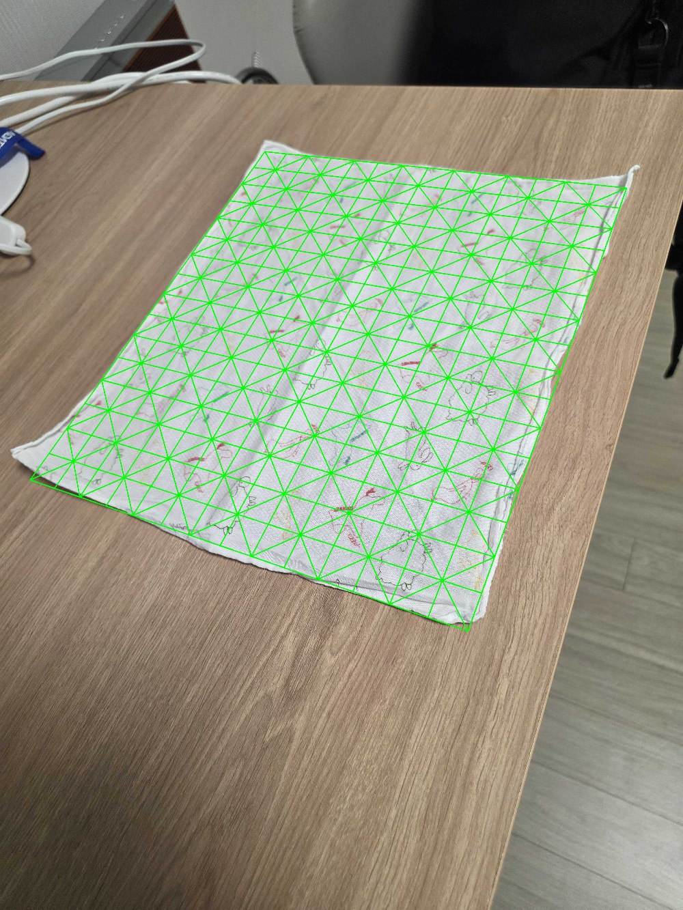
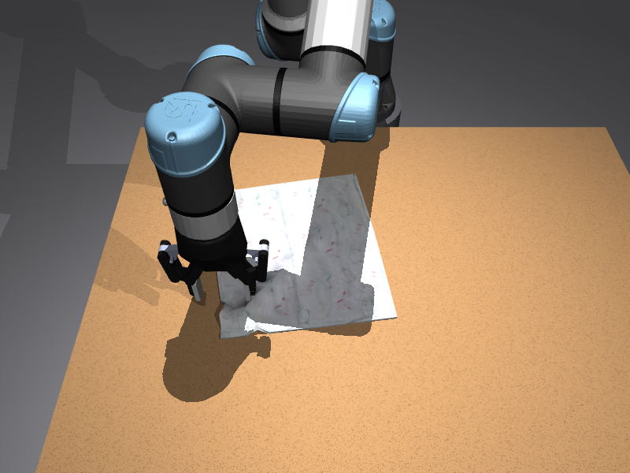
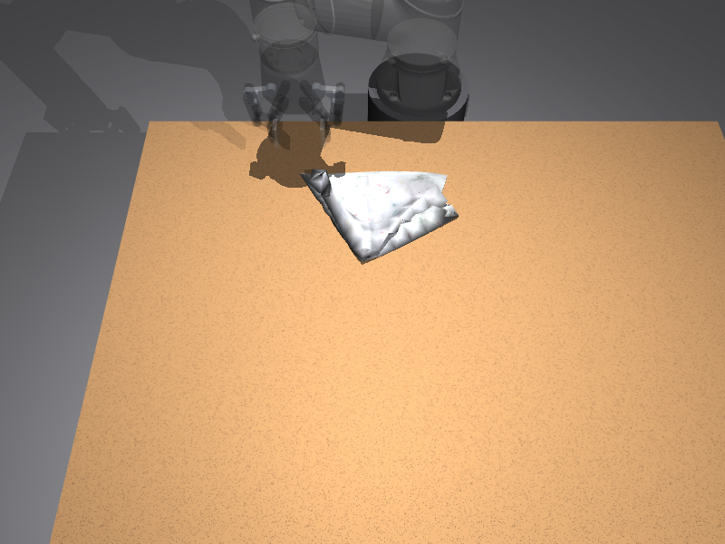

# DL Assignment 02 — 사진으로 만든 천(cloth)을 로봇이 두 번 접기: 강화학습

Assignment 01의 로봇(UR5e)과 테이블 그대로, 이번에는 **내가 찍은 천 사진 한 장으로 만든 메쉬**를 MuJoCo에 올려놓고
그리퍼로 천을 **대각선으로 두 번 접는(냅킨 접기)** 정책을 **강화학습(PPO)** 으로 학습합니다.

1. 천을 책상에 펴 놓고 사진 한 장을 찍어, 그 사진으로 시뮬레이터용 천 메쉬를 만듭니다 (Real2Sim).
2. 그 천을 MuJoCo 장면에 올리고, 키보드로 로봇을 조종해 직접 두 번 접어 봅니다.
3. 접기 한 번을 행동 하나(pick-and-place)로 보는 강화학습 환경에서, **관측(features)과 보상(reward)** 을 직접 설계합니다.
4. PPO로 학습하고(로컬 또는 Colab), 공통 평가 시드에서 성공률을 재고, 결과를 영상으로 만듭니다.
5. 보고서, 발표 PPT, YouTube 발표 영상으로 정리합니다.

| 사진 → 메쉬 | 시뮬레이터 | 두 번 접은 결과 |
|---|---|---|
|  |  |  |

## 설치

Python 3.10–3.12, GPU 필요 없음. **Assignment 01 환경을 그대로 써도 됩니다**(같은 MuJoCo 3.3.1 / robosuite 1.5.2). 강화학습 패키지만 추가됩니다.

```bash
git clone <this repo> DL_assignment02 && cd DL_assignment02
python -m venv .venv
# Windows:  .venv\Scripts\activate        macOS / Linux:  source .venv/bin/activate
pip install -r requirements.txt
python scripts/check_env.py --student <팀ID>
```

`PASSED`가 나오면 됩니다. `[robosuite WARNING] ... macro file`, `robosuite_models`, `mink` 경고는 무시하세요.

- **MuJoCo는 3.3.1로 고정**입니다. 새 버전(3.14에서 확인)은 천(flex)과 물체 하나 사이의 접촉을 50개로 제한해서, 천 꼭짓점 대부분이 테이블을 뚫고 떨어집니다.
- 사진 → 메쉬에서 SAM 분할을 쓰려면 `pip install -r requirements-mesh.txt` (torch, transformers; 처음 실행 때 모델 약 1 GB를 내려받습니다).
  설치가 부담되면 OpenCV만 쓰는 `--seg grabcut`, 모서리를 직접 찍는 `--seg click`이 있고, [Colab 노트북](notebooks/01_photo_to_mesh_colab.ipynb)도 있습니다.

## 빠른 시작

```bash
python mesh/photo2mesh.py --photo my_cloth.jpg --side_cm 32 --out assets/T03_cloth --seg sam   # 사진 -> 메쉬
python teleop.py --student T03 --mesh assets/T03_cloth                                          # 키보드로 직접 접기
python rl/check_rl.py                                                                           # 내 features / reward 검사
python rl/train_ppo.py --student T03                                                            # PPO 학습 (8코어 약 1시간)
python rl/eval_policy.py --agent ppo --ckpt runs/m3/ppo/ckpt.zip --video 3                      # 평가 + 영상
```

### teleop 키

| 키 | 동작 |
|---|---|
| 방향키 (누르고 있기) | 그리퍼를 테이블 평면에서 이동 (화면 기준, 위 = 카메라에서 멀어지는 쪽) |
| PgUp / PgDn | 그리퍼 위 / 아래 |
| Shift | 최고 속도 250 mm/s (기본은 절반) |
| **Home** | 그리퍼 닫기 / 열기. 닫으면 손가락 끝 3 cm 안의 천을 잡습니다 |
| Enter / Delete | 이 에피소드 저장하고 다음 시드 / 저장하지 않고 같은 시드 다시 |
| 창 닫기 | 종료 (진행 중인 에피소드는 저장하지 않음) |

빨간 공 두 개(c0, c2)와 파란 공 두 개(c1, c3)가 천의 모서리입니다. **같은 색끼리 만나게** 두 번 접으면 됩니다.
Space(뷰어 일시정지)와 Backspace(뷰어가 시뮬레이션을 초기화)는 누르지 마세요.
macOS는 `mjpython teleop.py ...`, 키 입력이 안 읽히면(macOS 권한, Wayland) `--keys viewer`를 씁니다 (Assignment 01과 같음).

## 구성

```
DL_assignment02/
├── README.md
├── requirements.txt, requirements-mesh.txt
├── mesh/photo2mesh.py          [M1] 사진 -> 천 메쉬 (분할, 사각형 맞춤, 카메라, 크기, 격자, 확인)
├── assets/cloth_example/       예시 천 (사진, 메쉬, texture, 확인 그림): 27.8 x 32.0 cm, 255 꼭짓점
├── teleop.py                   [M2] 키보드로 천 접기 -> demos/<팀ID>/ep_<seed>.npz
├── scripts/
│   ├── check_env.py            [M0, M1] 설치 / 메쉬 확인: 모서리를 잡아 들어 보고 그림 저장
│   ├── render_video.py         [M2, M4] 저장된 에피소드 -> mp4 (또는 --sheet 프레임 모음 png)
│   └── make_submission.py      [제출] zip 하나로 묶기
├── rl/
│   ├── features.py             [M3] 관측 설계                      TODO
│   ├── reward.py               [M3] 보상 설계                      TODO
│   ├── check_rl.py             [M3] 내 구현 검사 (학습 없이)
│   ├── fold_env.py             Gymnasium 환경: 한 step = 접기 1회 (완성본)
│   ├── train_ppo.py            [M3] PPO 학습 (stable-baselines3, 완성본)
│   └── eval_policy.py          [M4] 평가 (완성본)
├── notebooks/
│   ├── 01_photo_to_mesh_colab.ipynb   [M1] Colab GPU로 사진 -> 메쉬
│   └── 02_rl_colab.ipynb              [M3, M4] Colab에서 학습 / 평가
├── sim/                        시뮬레이터 (수정하지 마세요)
│   ├── scene.py                make_env(seed, mesh): 장면, 관측 구성, 시드 규칙
│   ├── cloth_env.py            UR5e + 그리퍼 + 천(flex), 잡기, 10 Hz 제어
│   ├── primitives.py           pick_place: 접기 1회 = 로봇 동작 열
│   ├── fold_metrics.py         모서리 간격, 덮인 면적, 성공 판정
│   ├── episode_io.py, level_table.py
├── data/                       테이블 좌표계, 로봇 시작 자세, 천 물성
└── docs/report_template.md     보고서 양식
```

## Milestone과 제출물

| | 내용 | 제출물 (만드는 명령) |
|---|---|---|
| **M0** | 설치와 실행 | `runs/m0/check_env.json`, `runs/m0/scene.png` (`scripts/check_env.py`) |
| **M1** | 내 천 사진 → 메쉬 → 시뮬레이터 | `assets/<팀ID>_cloth/` (`photo.jpg`, `cloth_mesh.npz`, `texture.png`, `mesh_report.json` `passed: true`, `corners.jpg`, `reprojection.jpg`), `runs/m1/check_env.json·scene.png` (`check_env.py --mesh assets/<팀ID>_cloth --out runs/m1`) |
| **M2** | teleop으로 직접 두 번 접기 | `demos/<팀ID>/` 에피소드 3개 이상 (그중 성공 1개 이상), 성공 영상 `runs/m2/teleop.mp4` (`render_video.py`) |
| **M3** | 강화학습 구현과 학습 | TODO를 채운 `rl/features.py`, `rl/reward.py`, `runs/m3/check_rl.json`, `runs/m3/ppo/ckpt.zip·train_log.csv·curve.png·config.json` |
| **M4** | 평가와 결과 영상 | `runs/m4/random/eval.json`, `runs/m4/ppo/eval.json` (예시 천, 평가 시드 50개 전부), `runs/m4/ppo_mycloth/eval.json` (내 천, 10개 이상), 결과 영상 `runs/m4/*/videos/*.mp4` **3개 이상** (성공·실패 포함) |
| **M5** | 최종 보고서, 발표 PPT, YouTube | `report.pdf` ([docs/report_template.md](docs/report_template.md)), `slides.pptx`(또는 `.pdf`), `youtube_url.txt` (5–10분 발표 영상) |

### 선택 과제 M6 — 나만의 변형 물체를 생성 모델로 Real2Sim (가산점, 배점은 추후 공지)

M0–M5를 끝낸 팀은 다뤄 보고 싶은 변형 물체 하나를 **생성 모델(image-to-3D)** 로 시뮬레이터에 옮겨 봅니다. M1은 천이 평평한 직사각형이라 사진의 기하로
메쉬를 만들었지만, M6에서는 아무 모양이나 3-D로 만들어 주는 생성 모델의 결과를 **시뮬레이터가 쓸 수 있는 형태로 고치고 물성을 맞추는 것**을 배웁니다.

1. **사진**: 물체 사진 1–4장, 줄자로 길이 하나
2. **생성 모델**: [TRELLIS](https://github.com/microsoft/TRELLIS) (GPU 필요 → Colab). 다른 선택: TripoSR, Stable Fast 3D, Hunyuan3D-2 (두 모델 비교도 좋은 ablation).
   시작점: [notebooks/01_photo_to_mesh_colab.ipynb](notebooks/01_photo_to_mesh_colab.ipynb) 끝의 TRELLIS 셀
3. **메쉬 정리** (trimesh / Open3D / Blender): 크기를 실측에 맞춤, 꼭짓점 수백 개로 단순화, 로프는 중심선 / 천·옷은 윗면·윤곽 / 단단한 부분은 그대로
4. **시뮬레이터 표현**: 로프 → cable, 천·옷 → flex 2D, 벨트 고리 → flex 1D, 기둥·풀리 → mesh geom
5. **Real vs Sim**: 같은 자세(예: 로프 한 끝을 20 cm 내밀기)를 실물 사진과 시뮬레이터에서 비교하고 물성 하나를 맞춤

예: 매듭 묶기, 옷 개기, 로프를 기둥에 감기, 타이밍 벨트를 두 풀리에 걸기, 또는 팀이 정한 것.
생성 모델의 한계를 기억하세요: 크기 단위가 없고, 안 보이는 뒷면은 상상한 것이며, 얇은 물체는 두께 있는 덩어리가 되고, 물성은 알려 주지 않습니다.

| 제출물 (`extra/<팀ID>/`) | |
|---|---|
| `photo.jpg`, `trellis_raw.glb` | 사진과 생성 모델 원본 |
| 정리 코드, 시뮬레이터 모델 (xml / py) | A02의 장면·로봇·잡기·영상 코드를 고쳐 써도 됩니다 |
| `compare.png` | 사진 \| 생성 모델 원본 \| 정리한 메쉬 \| 시뮬레이터, 한 줄로 |
| `real_vs_sim.png` | 같은 자세의 실물 사진과 시뮬레이터, 맞춘 물성 값 |
| 영상 1개 이상 | 과제를 하는 모습 (teleop / scripted / RL 중 하나) |

보고서에 M6 절(1–2쪽)을 넣고, 대면 평가 때 2–3분 시연을 추가합니다.

제출: `python scripts/make_submission.py --student <팀ID>` → `submission_<팀ID>.zip` (빠진 항목을 알려 줍니다)

## 팀, 일정, 평가

| | |
|---|---|
| **팀** | Assignment 01과 같은 팀(T01–T05). 모든 명령의 `--student`에 팀 ID |
| **제출** | **12월 2일 수업 시간**. 팀별로 `submission_<팀ID>.zip` 1개 |
| **평가** | 팀별 **약 15분 대면 평가**: M0→M5 순서로 코드를 설명하고 확인 시연. 교수님 질문에 팀원 모두 답할 수 있어야 합니다 |
| **준비물** | 설치가 끝난 노트북 1대 이상. 학습은 미리 끝내 두고(ckpt), 그 자리에서는 평가 몇 개와 영상을 다시 돌립니다 |

대면 평가에서 보여 줄 것

| 단계 | 그 자리에서 실행 | 설명할 코드 / 내용 |
|---|---|---|
| M0 | `python scripts/check_env.py --student <팀ID>` | `sim/cloth_env.py`의 장면 구성, 잡기(grasp) 방식 |
| M1 | 내 천 사진과 `corners.jpg`, `reprojection.jpg` | 소실점으로 초점거리, homography로 가로세로비를 구하는 원리. 잰 크기와 비교 |
| M2 | `python teleop.py --student <팀ID> --mesh assets/<팀ID>_cloth`로 잠깐 접기 | 사람이 접을 때 어려운 점 (그리고 그게 보상 설계에 주는 힌트) |
| M3 | `python rl/check_rl.py` | 직접 쓴 `features.py`, `reward.py`, 학습 곡선 |
| M4 | `python rl/eval_policy.py --agent ppo --ckpt runs/m3/ppo/ckpt.zip --n 3 --video 3` | 성공·실패 원인, random 대비 |
| M5 | 보고서 / PPT 핵심 슬라이드 | 설계 비교(ablation)와 결론 |

규칙
- `sim/`과 `data/`는 고치지 않습니다. 평가는 원래 시뮬레이터로 다시 돌려서 확인합니다.
- 평가 시드(`scene.EVAL_SEEDS`, 900000–900049)로 학습하거나 하이퍼파라미터를 고르지 않습니다. 학습은 팀 시드(T03 → 300–399)로 합니다.
- 관측(features)에는 실제 로봇도 알 수 있는 정보만 쓰세요. 보고서에 무엇을 썼는지, 왜 그런지 적습니다.

## 시뮬레이터 요약

- **천**: 사진에서 만든 삼각형 메쉬를 MuJoCo **flex**로 올립니다. 꼭짓점마다 작은 물체(3 slide joint), 삼각형 변은 길이 유지 제약(늘어나지 않는 면 천),
  굽힘 강성 없음, 질량 20 g, 테이블 마찰 1.0. **천끼리 충돌은 끕니다**(겹친 천이 서로 통과할 수 있음 — 켜면 3배 느리고 접기가 오히려 나빠졌습니다).
  물성은 실제 천에서 맞춘 값이 아닌 자리값입니다 (`data/cloth_physics.json`).
- **로봇**: Assignment 01과 같은 UR5e + Robotiq 2F-85, 같은 테이블 좌표계. 팔은 기구학으로 움직이고(행동 = 그리퍼 끝 속도, IK), 그리퍼는 아래를 향한 채 유지됩니다.
- **잡기**: 그리퍼를 닫으면 손가락 끝(TCP) 3 cm 안의 천 꼭짓점(최대 6개)을 TCP에 붙입니다(MuJoCo `connect` 제약). 열면 놓습니다.
- **관측** (80차원, `sim/scene.py`의 `OBS_LAYOUT`): 천 키포인트 25개(5 × 5 격자) xyz 75, TCP xyz 3, 그리퍼 닫힘 1, 잡은 꼭짓점 수 1. 위치는 작업 공간 중심 기준(m).
- **행동** (저수준, teleop): `[vx, vy, vz, grip]` ∈ [-1, 1], 1 = 250 mm/s, 10 Hz. **RL에서는** 접기 1회 = `pick_place(집을 점, 놓을 점)` (`sim/primitives.py`).
- **시작 상태**: 시드마다 천을 최대 30° 돌리고 3 cm 옮깁니다. 같은 시드는 언제나 같은 시작입니다.
- **성공** (`sim/fold_metrics.py`): 두 대각선 모서리 쌍(c0–c2, c1–c3)의 간격이 모두 **70 mm 이하**이고, 위에서 본 덮인 면적이 펼친 면적의 **35 % 이하**.
  기준은 모서리 위치를 아는 scripted 정책이 평가 시드 50개에서 88 % 성공하도록 정했습니다 (모서리 간격 중앙값 48 mm).
- **속도**: 노트북 CPU에서 대략 실시간 (물리 4 ms, 접기 1회 ≈ 5초 분량 → 계산 0.7–2초).

## 출처

- 로봇, 테이블 좌표계(`data/table_probe.json`), 로봇 시작 자세는 Assignment 01([real2sim_deformable](https://github.com/jooyongsim/real2sim_deformable))에서 가져왔습니다.
- 사진 → 천 메쉬 방법은 같은 연구실의 PhysTwin / MuJoCo 천 실험(2026-11-14)을 과제용으로 정리한 것입니다.
- 분할: [GroundingDINO](https://huggingface.co/IDEA-Research/grounding-dino-tiny), [SAM 2.1](https://huggingface.co/facebook/sam2.1-hiera-small). 강화학습: [stable-baselines3](https://stable-baselines3.readthedocs.io) PPO.
